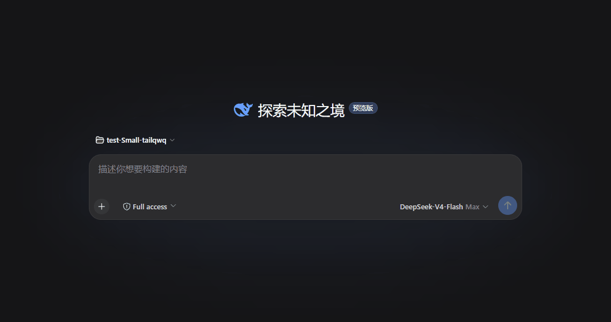

# dsh-tps

Live TPS badge for DSH Web: real-time tokens-per-second rendered inside the "Deep diving…" running-turn status row, sharing that row's natural visibility lifecycle.

中文: [README.md](README.md)



## Features

- **Instantaneous TPS only**: a rolling 5s window samples streamed output (UTF-8 bytes / 5 estimate); the reading shows `--` after 1.5s without new tokens and resets on step boundaries; the badge mounts only once the first value arrives (one-shot fade-in), so a fresh turn never shows a bare `TPS --`, while mid-turn pauses keep the dash
- **Visibility follows the host row, zero adaptation**: the badge lives inside the "Deep diving… 7分25秒" row, so it disappears with the row when the turn ends or a takeover panel (question/approval) hides the composer flow — no hide logic for todo strips, queue rows, or question panels
- **No duplication of built-in stats**: window averages (AVG/TTFT/token totals) are the built-in StatsLine's job; this plugin deliberately owns only the instantaneous rate
- **Hover fade**: a 2s hover dwell fades the badge out and makes it click-through (`pointer-events: none`); while hidden it stays hidden for as long as the cursor is on or near the badge (8px margin), and once the cursor moves away a 3s grace period elapses before it restores (a return to the badge area cancels the pending restore) — a parked cursor never loops the cycle
- **Pure front-end**: all readings derive from the conversation snapshot — no store, no event listeners, no network calls

## Installation (AI installation guide)

### Prerequisites

1. **A harness checkout containing the `conversation.chat.turnStatus` slot** (internal build). Verify:

   ```sh
   grep -n "conversation.chat.turnStatus" <harness>/packages/client/ui-conversation/src/client/apply.ts
   ```

   Output means the slot exists; nothing means the harness is too old — land the ui-conversation change that declares the slot first.

2. **Private repo access**: this is a private dsh-external repository; use an authenticated `gh` (or a PAT):

   ```sh
   gh auth status
   git clone https://github.com/dsh-external/dsh-tps.git
   ```

### Layout and dependencies

The plugin references the harness checkout through `link:` devDependencies, defaulting to sibling layouts:

```
deepseek-harness/   ← harness source checkout (with the turnStatus slot)
dsh-tps/            ← this repository
```

If your checkouts use another layout, adjust every `link:../../deepseek-harness/...` entry in `package.json`, then:

```sh
cd dsh-tps
pnpm install
```

### Mount into the Web profile (bundle way, recommended)

This package declares `dsh.bundle` (patch → `cordis.yml` in this repo), so it installs like an official plugin as a **profile bundle layer** — `dsh plugin` appends it to the profile's `dsh.profile.bundles` after install, with no hand-written inserts:

```sh
# From a local checkout (auto-builds and joins the bundles layer)
cd ~/Projects/deepseek-harness
dsh plugin --profile web add <path-to-this-repo>

# Or via a GitHub dependency
dsh plugin --profile web add github:dsh-external/dsh-tps
```

> Git installs run this package's `prepare` build script; if pnpm blocks the build, add the package to the profile's `pnpm-workspace.yaml` `allowBuilds` as prompted and retry.

### Manual mount (fallback)

Append to the harness Web profile (`~/.dsh/profiles/web/cordis.patch.yml`):

```yaml
- insert:
    - id: tps
      name: '@dsh-external/tps'
```

or launch with the overlay shipped here: `dsh web --patch ./cordis.yml`.

Also ensure the Web profile's dependency graph declares this package (bundle `package.json` or the profile's `dsh.profile.bundles` dependency), otherwise the Loader cannot resolve the row name.

### Build and activate

```sh
pnpm run build          # tsc + tsdown: emits lib/index.js and lib/client.js
```

- **Development mode** (`dsh web --dev` + `pnpm run dev:web` watcher): client-plugin bundles hot-reload after building.
- **Production mode**: **restart `dsh web`** after building (client bundle revs are computed at boot; a browser refresh alone may hit stale caches).

### Verify

While a turn runs you should see:

```
Deep diving… 7分25秒 | TPS 12.3
```

The row (and the badge) disappear when the turn ends or a takeover panel appears.

## Usage notes

- Badge type is 14px/500 (`--dsw-font-s-strong-14`) so Latin capitals and digits (~0.7em visual height) read comparably against the 13px full-square CJK clock glyphs
- Hover 2s → fade → click-through; stays hidden while the cursor is on or near the badge (8px margin), restores 3s after the cursor leaves (a return cancels the restore); re-hovering starts the dwell again
- All timings are compile-time constants in `src/client/TpsOverlay.tsx`; there is no client-plugin config channel yet

## Relationship to the official package

This repository is the standalone distribution; the upstream source mirrors `packages/client/ui-tps` in the DeepSeek Harness monorepo (official package name `@deepseek-ai/dsh-client-ui-tps`), differing only in the standalone build wrapper and the `@dsh-external/tps` naming.

## Known Limitations and Deferred Work

- **Estimated live tokens**: the streaming partial carries no live token counts, so the rate estimates tokens from UTF-8 bytes (bytes/5); exact accounting stays with the durable token-usage projection and the built-in StatsLine
- **Fixed hover timings**: the dwell/fade durations and the hide-area margin are compile-time constants; no client-plugin config channel to tune them per deployment
- **Internal slot dependency**: requires a harness with the `conversation.chat.turnStatus` slot (see prerequisites)

## License

BSD-3-Clause
